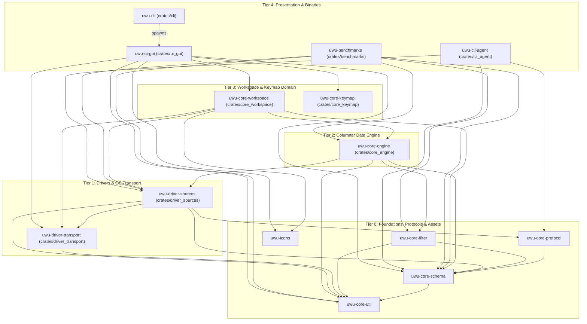

# Kiến trúc 5-Tier DAG & Quy chuẩn Lập trình (`ARCHITECTURE_AND_CONVENTIONS.md`)

Tài liệu này quy định kiến trúc đa crate, ranh giới phụ thuộc và các quy chuẩn lập trình bắt buộc của `uwulog-rust`. Mọi thay đổi đều được kiểm chứng tự động thông qua [verify_arch_and_conv.py](../scripts/verify_arch_and_conv.py) (`./.agents/scripts/harness.sh check-arch`).

---

## 1. Kiến trúc 5-Tier 1-Way DAG (14 Crates)

Phụ thuộc giữa 14 crates trong [Cargo.toml](../../Cargo.toml) bắt buộc chảy theo một chiều từ trên xuống (`Tier 4 -> Tier 3 -> Tier 2 -> Tier 1 -> Tier 0`):

### Bảng Ranh giới Phụ thuộc Chính xác

| Tier | Crate | Phụ thuộc nội bộ hợp lệ | Ranh giới cấm |
| :--- | :--- | :--- | :--- |
| **Tier 4** | `uwu-cli` | `[]` | Không phụ thuộc lẫn nhau giữa các crate Tier 4. |
| **Tier 4** | `uwu-ui-gui` | `core-workspace`, `core-keymap`, `driver-transport`, `core-schema`, `core-util`, `icons` (`egui`) | Không được import bởi bất kỳ crate nào ở Tier 0..3. |
| **Tier 4** | `uwu-cli-agent` | `driver-sources`, `core-protocol`, `core-schema` | Không kéo theo GUI (`egui`) hay Arrow (`core_engine`). |
| **Tier 4** | `uwu-benchmarks` | `core-engine`, `driver-sources`, `core-filter`, `core-schema`, `core-util` | Chỉ dùng để đo hiệu năng, không đưa logic sản phẩm vào đây. |
| **Tier 3** | `uwu-core-workspace` | `core-engine`, `driver-sources`, `driver-transport`, `core-schema`, `icons` | Không phụ thuộc `ui_gui` hay `core_keymap`. |
| **Tier 3** | `uwu-core-keymap` | `[]` *(optional `egui` feature)* | Không phụ thuộc `ui_gui` hay `core_workspace`. |
| **Tier 2** | `uwu-core-engine` | `driver-sources`, `core-filter`, `core-schema`, `core-util` | Không biết gì về workspace, UI hay keymap. |
| **Tier 1** | `uwu-driver-sources` | `driver-transport`, `core-protocol`, `core-schema`, `core-util` | Cấm phụ thuộc `core_engine` (Arrow) hoặc `core_filter`. |
| **Tier 1** | `uwu-driver-transport` | `core-util` | Cấm phụ thuộc `driver_sources`, `core_engine`, `core_filter`. |
| **Tier 0** | `uwu-core-filter` | `core-schema`, `core-util` | Cấm I/O mạng/disk/process và mọi Tier trên. |
| **Tier 0** | `uwu-core-protocol` | `core-schema` | Chỉ định nghĩa envelope và framed reader/writer. |
| **Tier 0** | `uwu-core-schema` | `core-util` | Single Source of Truth cho `LogEvent`, `StandardField`, `LogFields`. |
| **Tier 0** | `uwu-core-util` | `[]` | Tiện ích thuần (timestamp, ANSI strip, ASCII SIMD scan, command builder). |
| **Tier 0** | `uwu-icons` | `[]` *(optional `egui` feature)* | Không phụ thuộc crate nội bộ khác. |

---

## 2. Quy chuẩn Lập trình (Project Conventions)

### 2.1. Phân loại & Đặt tên (Taxonomy)
- Thư mục crate dùng prefix rõ nghĩa: `core_*`, `driver_*`, `ui_*`, `cli_*`.
- Tên package trong `Cargo.toml` khớp chính xác mẫu `uwu-<dir_name>` (thay `_` bằng `-`).

### 2.2. SSOT Schema & Cột Hệ thống Arrow
- Mọi tên trường chuẩn (`timestamp`, `level`, `message`, `id`) và bí danh (`ts`, `time`, `@timestamp`, `lvl`, `severity`, `msg`, `body`...) chỉ được định nghĩa qua `StandardField` tại [crates/core_schema/src/lib.rs](../../crates/core_schema/src/lib.rs); key `"id"` của log người dùng không còn bị alias sang `LogEvent.id` nội bộ.
- Mọi cột nội bộ trong `ArrowStorage` dùng tiền tố hai gạch dưới `__`:
  - `__id` (`UInt64`, non-null)
  - `__color` (`UInt8`, non-null)
  - `__timestamp` (`Utf8`, non-null)
  - `__timestamp_secs` (`Float64`, nullable)
  - `__message` (`Utf8`, non-null)
- Mọi cột dữ liệu người dùng dùng tiền tố `f:` (`f:<key>`, kèm metadata `uwu.json="1"` cho cột thuần array/object), và cột đánh dấu `null` tường minh dùng tiền tố `n:` (`n:<key>`, `Boolean`).

### 2.3. Tối ưu Bộ nhớ Hot Path (Zero-Allocation)
- **Ưu tiên `Cow<'_, str>`**: Dùng `value_to_cow`, `LogEvent::get_field_cow`, `strip_ansi` để tránh `.to_string()` khi không cần biến đổi chuỗi.
- **Mảng phẳng `LogFields`**: Lưu trường động trong `LogFields(Vec<(String, Value)>)` ([fields.rs](../../crates/core_schema/src/fields.rs)) thay vì `HashMap` cho mỗi log event.
- **Tìm kiếm byte tăng tốc**: Dùng `memchr` (`contains_ignore_case_ascii_bytes` trong `core_util`) và bộ format số trên stack (`format_i64`, `format_u64`, `format_f64` trong `compiler.rs`).
- **Zero-Lookup `BatchColumns`**: Trích xuất mảng Arrow 1 lần trước vòng lặp hàng thay vì gọi `batch.column_by_name()` theo từng dòng.

### 2.4. An toàn Thực thi & Chống Panic (No-Panic Runtime)
- Ngoài khối `#[cfg(test)]` và `tests/`, không gọi `.unwrap()` hay `.expect()` lên JSON đầu vào, chuỗi UTF-8, regex người dùng nhập, channel, hoặc `RwLock`/`Mutex`.
- Tầng I/O / CLI dùng `anyhow::Result` kèm `.context(...)`; tầng parser/library dùng `Option` / typed errors (như `KeystrokeParseError`, `ContextParseError`).

### 2.5. Kỷ luật Khóa & Ngân sách 60 FPS
- Không giữ `RwLock`/`Mutex` qua điểm `.await` hoặc trong khi chạy `LogNormalizer::normalize` / `detect_timestamp_format`.
- Luồng UI `egui` giữ frame budget `< 16.6ms`: mọi tác vụ I/O, tailing, tìm kiếm trên tập lớn và phân trang ngược đều chạy bất đồng bộ trên Tokio/Rayon và trả kết quả về qua `AppEvent`.

---

## 3. Anti-Patterns Cần Tránh

1. Thêm dependency vào `Cargo.toml` tạo cạnh ngược từ Tier thấp lên Tier cao hoặc giữa `driver_transport` $\rightarrow$ `driver_sources`.
2. Thêm biến thể mới vào `enum Expr` (`core_filter/src/parser.rs`) mà quên cập nhật `evaluator.rs` hoặc `core_engine/src/arrow_storage/compiler.rs` (sẽ bị `check-arch` chặn ngay).
3. Chạy `std::thread::sleep` hoặc `std::process::Command` đồng bộ trên UI thread của `ui_gui`.
4. Hardcode `Color32::from_rgb(...)` trong `ui_gui/src/views/` hoặc `components/` thay vì lấy từ `theme::tokens`.
