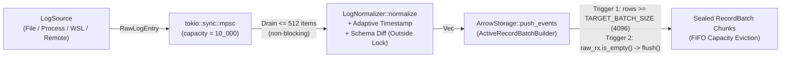
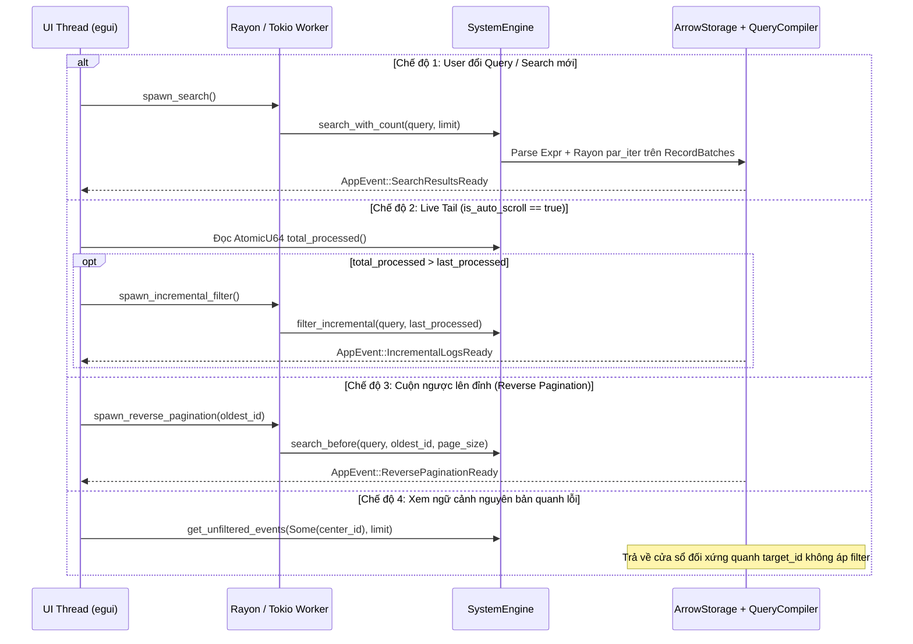
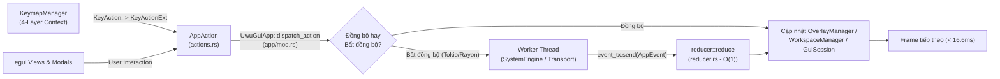
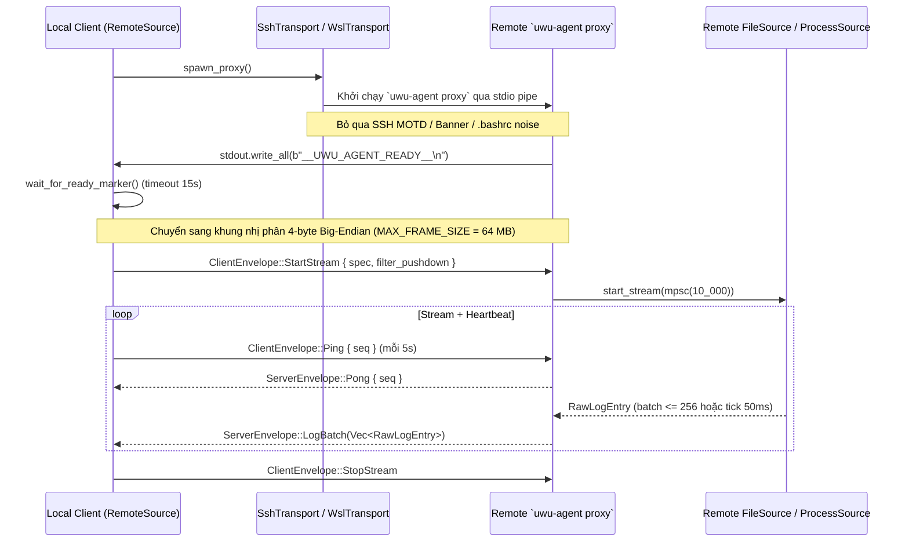

# Luồng Dữ liệu & Vòng đời Hệ thống (`SYSTEM_FLOWS_AND_LIFECYCLES.md`)

Tài liệu này mô tả 4 luồng vận hành cốt lõi của `uwulog-rust` kèm các điểm chạm mã nguồn chính xác.

---

## 1. Flow A — Luồng Nạp Log & Dual-Trigger Arrow Flush

Nguồn log bất kỳ (`FileSource`, `ProcessSource`, `WslSource`, `RemoteSource`) đều đẩy `RawLogEntry` qua một đường ống bất đồng bộ trước khi vào `ArrowStorage`:

### Chi tiết thực thi
1. **Channel Drain ([crates/core_engine/src/lib.rs](../../crates/core_engine/src/lib.rs))**: Task nền của `SystemEngine::new` chờ phần tử đầu tiên bằng `raw_rx.recv().await`, sau đó rút không chặn tối đa `512` phần tử (`try_recv()`).
2. **Xử lý Ngoài Khóa Lưu trữ**:
   - `LogNormalizer::normalize` ([normalizer.rs](../../crates/driver_sources/src/normalizer.rs)) bỏ mã màu ANSI qua `strip_ansi` (`Cow<'_, str>`), parse JSON nếu chuỗi bắt đầu/kết thúc bằng `{}`/`[]`, làm phẳng object lồng nhau bằng dấu `.`, và trích `timestamp`/`level`/`message` trong 1 lượt duyệt qua `StandardField::from_alias`.
   - `SystemEngine` áp dụng **Adaptive Timestamp** (`parse_with_format` fast-path, tự dò lại bằng `detect_timestamp_format` khi đổi định dạng) và **Change-Driven Schema Discovery** (chỉ xin write lock `schema` / `known_keys` khi có key mới hoặc promote `Text -> Number`).
3. **Dual-Trigger Flush ([storage.rs](../../crates/core_engine/src/arrow_storage/storage.rs))**:
   - Đẩy batch vào `ActiveRecordBatchBuilder` (gộp nếu tổng dòng $\le$ `TARGET_BATCH_SIZE = 4096`).
   - Khi `raw_rx.is_empty()`, gọi ngay `storage_clone.flush()` để đóng gói batch đang mở thành `RecordBatch` bất biến, đảm bảo log đến thưa vẫn hiển thị tức thì trên UI.

---

## 2. Flow B — Luồng Biên dịch Truy vấn Vector hóa & 4 Chế độ Viewport

---

## 3. Flow C — Luồng Điều phối Giao diện Một Chiều (`ui_gui`)

- **Ngữ cảnh phím tắt (`resolve_active_key_context`)**: `OverlayLayer::RemoteServersModal` $\rightarrow$ `RemoteServers`; các modal/picker khác $\rightarrow$ `Modal`; khi `autocomplete.is_open` $\rightarrow$ `Autocomplete`; focus ô tìm kiếm $\rightarrow$ `SearchInput`; mặc định $\rightarrow$ `Table` (kế thừa từ `Global`).

---

## 4. Flow D — Luồng Bắt tay & Truyền tải Remote Agent (`uwu-agent`)

- **Quy tắc tách kênh**: Ở chế độ `proxy`, `uwu-agent` chỉ ghi `AGENT_READY_MARKER` và các frame nhị phân ra `stdout`; mọi diagnostic/panic trace đều ghi ra `stderr`.
